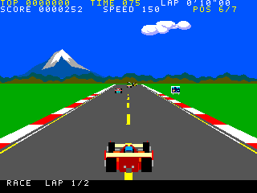
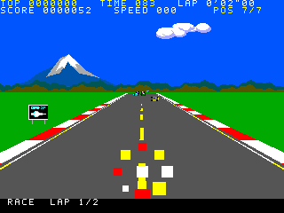
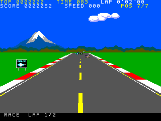

# Actual race and effect captures

The final fixture draws the maintained race panorama, HUD/footer, road, traffic,
signs and player, with no diagnostic title or attract panel. Baseline and additive
output at the matched frame300 are pixel-identical (76,800pixels); both page
parities and the actual maintained explosion/blink drawing are captured.

1. `CAPTURE-RESULTS.json` identifies each original profile, successful capture,
   ordered post-swap generation/request, exact input/runtime hashes and scene
   hashes. Successful cases from a session with a later unrelated startup stall
   retain their original provenance; failures are separately excluded.
2. The actor viewport ends at223, while the road refresh includes the footer
   through239. Traffic can touch textured sky from row100; production panorama
   restoration covers88–103. No retained sky row is assumed to be a solid colour.
3. Crash/recovery uses maintained `Crash`/`drawPlayer`:150 explosion frames,
   60 hidden blink frames and one recovery transition. The separate completed
   `racecoverage03` run passes all272 effect frames and returns to MOS. Native
   physics is frozen during that drawing diagnostic; it does not qualify
   integrated opponent destruction or recovery scheduling.
4. Captures deliberately stop during a fenced no-VDP-traffic hold. Their timings
   and interrupted cleanup are excluded. Normal900-frame races and completed
   coverage provide timer restoration, Stop/UNLOAD and clean MOS-return evidence.
   The Author's moving visual review remains the final appearance gate.

The final guest is33116db786ef08033a3c5aa3404a7d5ed8411013af9b70ac27051ddd1ade53e9.
Raw attempts and preparation revisions are preserved; no hardware was used.
